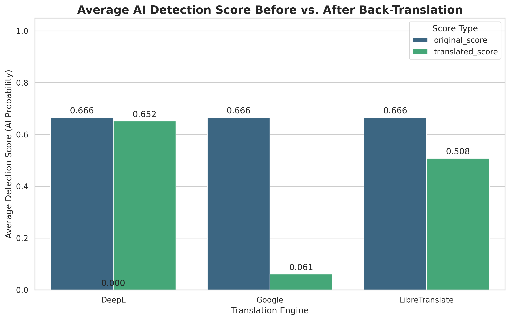
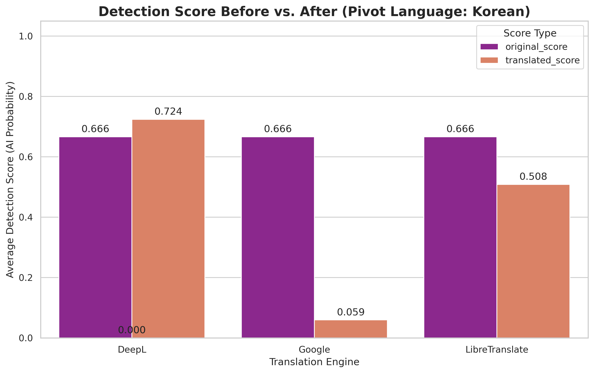
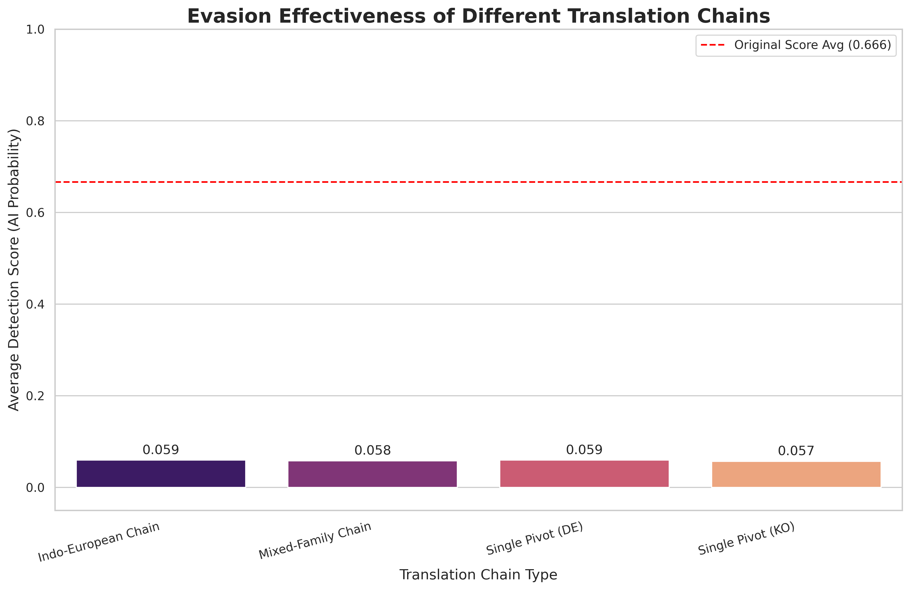

# Back-Translation Based AI-Generated Text Detection Evasion: An Experimental Study

[Paper Link](https://kiss.kstudy.com/Detail/Ar?key=4210021)

**Authors:** Seungwoo Lim, Jihie Kim  
**Affiliation:** Department of Computer Science and Artificial Intelligence, Dongguk University  
**Contact:** daniel73919@gmail.com, jihie.kim@dgu.edu

---

## 🔍 Overview

This research systematically analyzes the key variables that determine the success rate of back-translation attacks on AI text detectors, including:
- **Translation engine quality**
- **Grammatical distance of pivot languages**
- **Structural complexity of translation paths**

Using the ESPERANTO public dataset and RoBERTa-based detection models, we discovered counter-intuitive phenomena where standard-quality translators (Google Translate) outperform high-quality translators (DeepL) in evading detection.

### Key Discovery: Adversarial Purification

When using grammatically distant languages like Korean, high-quality translation engines can **increase** AI detection scores—a phenomenon we term "Adversarial Purification."

---

## 🎯 Key Findings

1. **Standard-quality translation engines are most effective** for detection evasion (Google Translate > DeepL)
2. **High-quality engines + distant languages = paradoxical effect**: DeepL with Korean increased detection scores by 8.7%
3. **Primacy of the First Step**: Attack success is determined by the strongest initial transformation, not path complexity or iteration count
4. **Current detection models are highly vulnerable** to statistical perturbations from machine translation

---

## 🧪 Experimental Design

### Dataset & Detection Model
- **Dataset**: ESPERANTO news article samples
- **Detector**: `roberta-base-openai-detector` (Hugging Face)
- **Detection Score**: Probability value between 0 and 1 (closer to 1 = AI-generated)

### Independent Variables

#### 1. Translation Engine Quality
- **High-quality**: DeepL
- **Standard-quality**: Google Translate
- **Open-source**: LibreTranslate

#### 2. Pivot Language Phylogenetic Distance
- **Close to English**: German (DE) - Indo-European family
- **Distant from English**: Korean (KO) - Language isolate

#### 3. Translation Path Structure
- **Iteration Depth**: 1, 3, 5 repetitions
- **Path Complexity**: Single-language vs. multi-language chain translation

---

## 🔬 Experiments

### Experiment 1: Translation Engine Quality (with German Pivot)

### Experiment 2: Linguistic distance

### Experment 3: Depth of Back translation loop

### Experiment 4: Iteration complexity of back translation